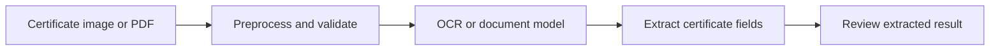
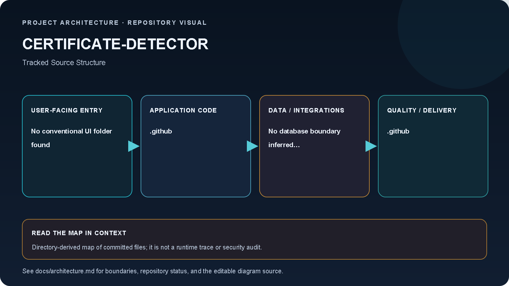

# Certificate Detector

<strong>A project space for building tools that inspect certificate documents and identify useful information.</strong>

## Project status

This GitHub repository currently contains its license and ignore rules, but no application source, model, sample data, or run instructions. It is not a runnable certificate-detection app yet.

## Suggested implementation flow

This is an intended workflow diagram, not a description of code already implemented here. Add the application, dependencies, sample inputs, privacy guidance, and reproducible run steps before presenting detection results as available.

## Live concept preview

[Open the interactive prototype](https://kalyan870.github.io/certificate-detector/). This is a static concept preview using sample data, not a production backend. See the limitation notice in the app.

## Architecture

[Architecture notes](docs/architecture.md) · [Editable SVG](docs/images/certificate-detector-architecture.svg)
